  

<h2 align="center">Programming Languages</h2>

DTU has taken me across a lot of ground, from object-oriented and functional programming down to code that talks directly to hardware, and I keep adding new languages and tools as I go.

I care about writing code that is clean and easy to maintain. I'm always glad to pick up a new language or dig deeper into one I already know, whether that means managing memory by hand in C++ or putting together a quick prototype in Python.

  
  
  
  
  

<h2 align="center">Frameworks & Libraries</h2>

For applications I mostly reach for React, and for AI work I build agents with LangChain and LangGraph. On the hardware side I use Chisel to describe digital circuits in Scala.

  
  
  
  

